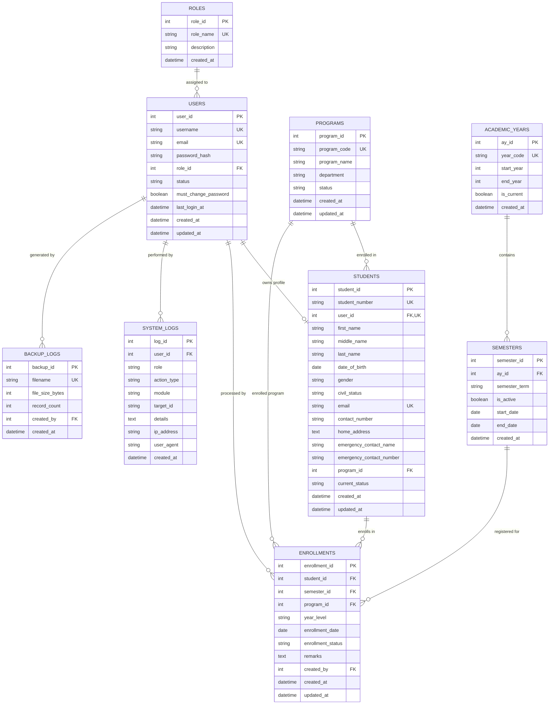
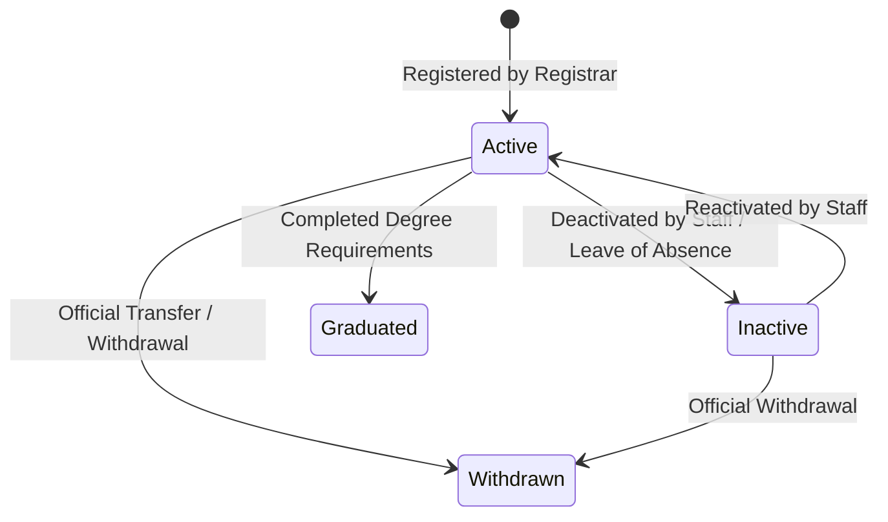
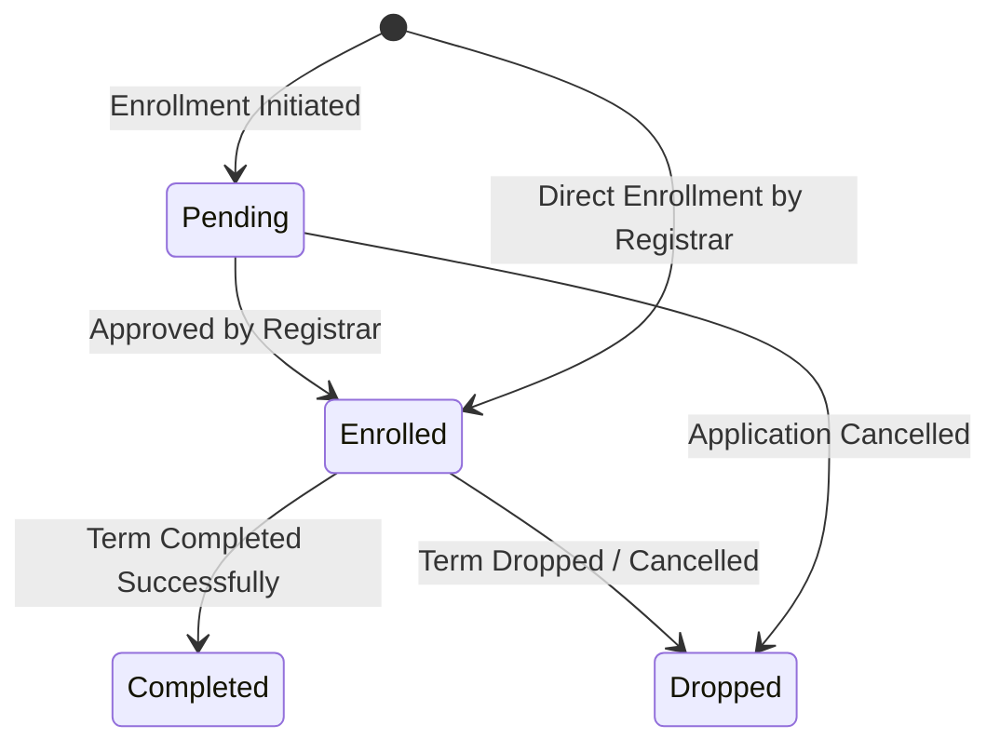

# Database Architecture & Data Model: Student Information System (SIS)

**Feature**: Student Information System (SIS)  
**Date**: 2026-11-07  
**Status**: Completed  
**Governing Document**: `.specify/memory/constitution.md`

## 1. Entity-Relationship Diagram (ERD)

---

## 2. Detailed Table Specifications

### Table: `roles`
Stores the authorization roles in the system.

| Column | Type | Constraints | Description |
| :--- | :--- | :--- | :--- |
| `role_id` | INT AUTO_INCREMENT | PRIMARY KEY | Unique role identifier |
| `role_name` | VARCHAR(50) | NOT NULL, UNIQUE | Canonical name (`Administrator`, `Registrar`, `Student`) |
| `description` | VARCHAR(255) | NULL | Purpose of role |
| `created_at` | DATETIME | NOT NULL, DEFAULT CURRENT_TIMESTAMP | Record creation timestamp |

*Default Seeds*:
- `(1, 'Administrator', 'Full institutional administration and system oversight')`
- `(2, 'Registrar', 'Student records, registration, and enrollment management')`
- `(3, 'Student', 'Personal profile and enrollment record access')`

---

### Table: `users`
Stores user credentials, role references, and authentication states.

| Column | Type | Constraints | Description |
| :--- | :--- | :--- | :--- |
| `user_id` | INT AUTO_INCREMENT | PRIMARY KEY | Unique user account identifier |
| `username` | VARCHAR(50) | NOT NULL, UNIQUE | Login handle (or Student ID for students) |
| `email` | VARCHAR(100) | NOT NULL, UNIQUE | Institutional or personal email |
| `password_hash` | VARCHAR(255) | NOT NULL | BCRYPT password hash generated via `password_hash()` |
| `role_id` | INT | NOT NULL, FOREIGN KEY (`roles.role_id`) | Assigned authorization role |
| `status` | ENUM('Active', 'Inactive') | NOT NULL, DEFAULT 'Active' | Account availability status |
| `must_change_password` | TINYINT(1) | NOT NULL, DEFAULT 0 | 1 = Force password change on first login |
| `last_login_at` | DATETIME | NULL | Timestamp of most recent successful login |
| `created_at` | DATETIME | NOT NULL, DEFAULT CURRENT_TIMESTAMP | Account creation timestamp |
| `updated_at` | DATETIME | NOT NULL, DEFAULT CURRENT_TIMESTAMP ON UPDATE CURRENT_TIMESTAMP | Record update timestamp |

---

### Table: `programs`
Represents academic courses and degree programs.

| Column | Type | Constraints | Description |
| :--- | :--- | :--- | :--- |
| `program_id` | INT AUTO_INCREMENT | PRIMARY KEY | Unique program identifier |
| `program_code` | VARCHAR(20) | NOT NULL, UNIQUE | Short acronym (e.g., `BSCS`, `BSIT`, `BEED`, `BSBA`) |
| `program_name` | VARCHAR(150) | NOT NULL | Complete title (e.g., `Bachelor of Science in Computer Science`) |
| `department` | VARCHAR(100) | NOT NULL | Academic college or department |
| `status` | ENUM('Active', 'Inactive') | NOT NULL, DEFAULT 'Active' | Offering availability |
| `created_at` | DATETIME | NOT NULL, DEFAULT CURRENT_TIMESTAMP | Record creation timestamp |
| `updated_at` | DATETIME | NOT NULL, DEFAULT CURRENT_TIMESTAMP ON UPDATE CURRENT_TIMESTAMP | Record update timestamp |

---

### Table: `academic_years`
Stores institutional academic calendar years.

| Column | Type | Constraints | Description |
| :--- | :--- | :--- | :--- |
| `ay_id` | INT AUTO_INCREMENT | PRIMARY KEY | Academic year identifier |
| `year_code` | VARCHAR(20) | NOT NULL, UNIQUE | Academic year code (e.g., `2025-2026`, `2026-2027`) |
| `start_year` | INT | NOT NULL | Calendar year start (e.g., `2026`) |
| `end_year` | INT | NOT NULL | Calendar year end (e.g., `2027`) |
| `is_current` | TINYINT(1) | NOT NULL, DEFAULT 0 | 1 = Current institutional academic year |
| `created_at` | DATETIME | NOT NULL, DEFAULT CURRENT_TIMESTAMP | Record creation timestamp |

---

### Table: `semesters`
Stores specific academic semesters or terms within an academic year.

| Column | Type | Constraints | Description |
| :--- | :--- | :--- | :--- |
| `semester_id` | INT AUTO_INCREMENT | PRIMARY KEY | Semester identifier |
| `ay_id` | INT | NOT NULL, FOREIGN KEY (`academic_years.ay_id`) ON DELETE RESTRICT | Linked academic year |
| `semester_term` | ENUM('1st Semester', '2nd Semester', 'Summer') | NOT NULL | Term designation |
| `is_active` | TINYINT(1) | NOT NULL, DEFAULT 0 | 1 = Currently active enrollment semester |
| `start_date` | DATE | NOT NULL | Start of term date |
| `end_date` | DATE | NOT NULL | End of term date |
| `created_at` | DATETIME | NOT NULL, DEFAULT CURRENT_TIMESTAMP | Record creation timestamp |

*Composite Unique Key*: `UNIQUE KEY uq_ay_term (ay_id, semester_term)` prevents duplicate term configurations.

---

### Table: `students`
Stores complete student biographical and demographic records.

| Column | Type | Constraints | Description |
| :--- | :--- | :--- | :--- |
| `student_id` | INT AUTO_INCREMENT | PRIMARY KEY | Internal surrogate primary key |
| `student_number` | VARCHAR(20) | NOT NULL, UNIQUE | Official institutional student number (`YYYY-NNNNN`) |
| `user_id` | INT | NULL, UNIQUE, FOREIGN KEY (`users.user_id`) ON DELETE SET NULL | Linked student login account |
| `first_name` | VARCHAR(50) | NOT NULL | Given name |
| `middle_name` | VARCHAR(50) | NULL | Middle name |
| `last_name` | VARCHAR(50) | NOT NULL | Family/surname |
| `date_of_birth` | DATE | NOT NULL | Birth date |
| `gender` | ENUM('Male', 'Female', 'Other') | NOT NULL | Gender |
| `civil_status` | ENUM('Single', 'Married', 'Widowed', 'Separated') | NOT NULL, DEFAULT 'Single' | Civil status |
| `email` | VARCHAR(100) | NOT NULL, UNIQUE | Student email address |
| `contact_number` | VARCHAR(25) | NOT NULL | Primary mobile/phone number |
| `home_address` | TEXT | NOT NULL | Permanent/residential address |
| `emergency_contact_name` | VARCHAR(100) | NOT NULL | Emergency contact person |
| `emergency_contact_number`| VARCHAR(25) | NOT NULL | Emergency phone number |
| `program_id` | INT | NOT NULL, FOREIGN KEY (`programs.program_id`) ON DELETE RESTRICT | Primary enrolled degree program |
| `current_status` | ENUM('Active', 'Inactive', 'Graduated', 'Withdrawn') | NOT NULL, DEFAULT 'Active' | Institutional student standing |
| `created_at` | DATETIME | NOT NULL, DEFAULT CURRENT_TIMESTAMP | Registration timestamp |
| `updated_at` | DATETIME | NOT NULL, DEFAULT CURRENT_TIMESTAMP ON UPDATE CURRENT_TIMESTAMP | Profile update timestamp |

---

### Table: `enrollments`
Official academic term enrollments for students.

| Column | Type | Constraints | Description |
| :--- | :--- | :--- | :--- |
| `enrollment_id` | INT AUTO_INCREMENT | PRIMARY KEY | Unique enrollment identifier |
| `student_id` | INT | NOT NULL, FOREIGN KEY (`students.student_id`) ON DELETE RESTRICT | Enrolled student |
| `semester_id` | INT | NOT NULL, FOREIGN KEY (`semesters.semester_id`) ON DELETE RESTRICT | Enrolled academic term |
| `program_id` | INT | NOT NULL, FOREIGN KEY (`programs.program_id`) ON DELETE RESTRICT | Degree program during enrollment |
| `year_level` | ENUM('1st Year', '2nd Year', '3rd Year', '4th Year', '5th Year') | NOT NULL | Academic year classification |
| `enrollment_date` | DATE | NOT NULL | Date enrollment was processed |
| `enrollment_status` | ENUM('Pending', 'Enrolled', 'Dropped', 'Completed') | NOT NULL, DEFAULT 'Enrolled' | Current enrollment standing |
| `remarks` | TEXT | NULL | Administrative remarks or conditions |
| `created_by` | INT | NOT NULL, FOREIGN KEY (`users.user_id`) | Staff member who processed enrollment |
| `created_at` | DATETIME | NOT NULL, DEFAULT CURRENT_TIMESTAMP | Record creation timestamp |
| `updated_at` | DATETIME | NOT NULL, DEFAULT CURRENT_TIMESTAMP ON UPDATE CURRENT_TIMESTAMP | Record update timestamp |

*Composite Unique Key*: `UNIQUE KEY uq_student_semester (student_id, semester_id)` strictly prohibits duplicate enrollments for the same student in the same semester.

---

### Table: `system_logs`
Audit trail recording security and operational modifications.

| Column | Type | Constraints | Description |
| :--- | :--- | :--- | :--- |
| `log_id` | INT AUTO_INCREMENT | PRIMARY KEY | Unique log entry identifier |
| `user_id` | INT | NULL, FOREIGN KEY (`users.user_id`) ON DELETE SET NULL | Actor user account (NULL if unauthenticated) |
| `role` | VARCHAR(50) | NOT NULL | User role at time of action (`Administrator`, `Registrar`, etc.) |
| `action_type` | VARCHAR(50) | NOT NULL | Action category (`LOGIN`, `LOGOUT`, `CREATE`, `UPDATE`, `DEACTIVATE`, `BACKUP`) |
| `module` | VARCHAR(50) | NOT NULL | Target module (`AUTH`, `STUDENTS`, `ENROLLMENT`, `USERS`, `DATABASE`) |
| `target_id` | VARCHAR(50) | NULL | Identifier of affected record (e.g., student ID, user ID) |
| `details` | TEXT | NOT NULL | Human-readable description of event |
| `ip_address` | VARCHAR(45) | NOT NULL | Client IP address (supports IPv4 and IPv6) |
| `user_agent` | VARCHAR(255) | NULL | Browser User-Agent header |
| `created_at` | DATETIME | NOT NULL, DEFAULT CURRENT_TIMESTAMP | Timestamp of activity |

---

### Table: `backup_logs`
Tracks database backups created by administrators.

| Column | Type | Constraints | Description |
| :--- | :--- | :--- | :--- |
| `backup_id` | INT AUTO_INCREMENT | PRIMARY KEY | Unique backup record identifier |
| `filename` | VARCHAR(150) | NOT NULL, UNIQUE | Generated SQL dump filename |
| `file_size_bytes` | BIGINT | NOT NULL | File size in bytes |
| `record_count` | INT | NOT NULL, DEFAULT 0 | Total records exported across tables |
| `created_by` | INT | NOT NULL, FOREIGN KEY (`users.user_id`) | Administrator who triggered backup |
| `created_at` | DATETIME | NOT NULL, DEFAULT CURRENT_TIMESTAMP | Timestamp of backup creation |

---

## 3. Entity State Transitions

### Student Status Lifecycle

### Enrollment Status Lifecycle

